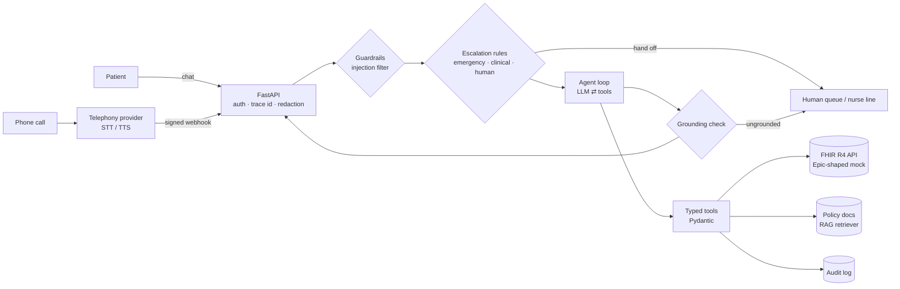

# Patient Access Agent

[](https://github.com/hrutishaa/patient-access-agent/actions/workflows/ci.yml)

A production-style **AI voice + chat agent for hospital patient access**: it verifies a caller's identity,
finds open slots, books and cancels appointments through a **FHIR R4** API, answers clinic-policy
questions with retrieval (RAG), and **hands off to a human** whenever it should.

> **Scope, honestly:** this is a portfolio project built on **synthetic data only**. It is not deployed at
> any hospital and has never touched real PHI. The FHIR server is a mock shaped like Epic's FHIR scheduling
> APIs so the integration layer can be swapped for a real sandbox (e.g. Epic on FHIR / open.epic) later.

**Live demo (static):** https://hrutishaa.github.io/patient-access-agent/ (transcripts + eval results)

## What it does
| Capability | Where |
|---|---|
| FastAPI service, OAuth2 password flow → short-lived JWT, role scopes (patient / staff / admin) | `app/auth.py`, `app/main.py` |
| PHI redaction in every log line (names, DOB, phone, email, SSN, MRN) | `app/observability.py` |
| Append-only **audit log** of every PHI access, patient ids pseudonymized | `app/audit.py` |
| Mock **FHIR R4** Patient / Practitioner / Slot / Appointment with `$book` and `$cancel` | `app/fhir/` |
| Tool-calling agent loop (OpenAI-compatible) + deterministic **offline MockLLM** | `app/agent.py`, `app/llm.py` |
| Tools: `lookup_patient` (identity verification), `find_slots`, `book_appointment`, `cancel_appointment`, `list_appointments`, `answer_faq` (RAG) | `app/tools.py` |
| Safe escalation: emergency → "call 911", clinical → nurse, user asks for human, low confidence, repeated failure | `app/escalation.py` |
| Guardrails: Pydantic tool args, **grounding check** (no time/id/clinician the tools didn't return), prompt-injection filter | `app/guardrails.py` |
| Voice channel: `/voice` webhook (HMAC-signed), transcript in → SSML out, pluggable for Twilio / Cisco / ElevenLabs | `app/voice.py` |
| Eval harness: 21 scripted multi-turn conversations, quality gates in CI | `eval/` |
| Structured JSON logs, trace id per request, latency per turn, optional LangSmith | `app/observability.py` |

## Architecture


**Turn flow:** request → JWT/scope check → injection filter → rule-based escalation (runs *before* any
model, so emergencies never depend on an LLM) → LLM chooses a tool → args validated → tool calls FHIR,
writes audit → LLM writes reply from tool output → grounding check → reply (chat JSON or SSML).

## Design decisions
- **Rules before the model for safety.** Emergency and clinical-advice detection is deterministic and tested.
  A model can add nuance later, but it can never *remove* an escalation.
- **Identity before PHI.** No patient tool runs until `lookup_patient` matches first name + last name + DOB
  exactly. Tools also re-check that the `patient_id` belongs to *this* session, so a model cannot be talked into
  reading someone else's record. Logged-in patients are bound to their own record.
- **Minimum necessary.** `lookup_patient` returns only id + first name to the model, not phone/MRN.
- **Grounding check.** Every appointment fact the agent says (date/time, confirmation id, clinician) must have
  come back from a tool this session; otherwise the reply is replaced and the conversation is handed off.
- **Offline MockLLM.** Tests, eval and the demo run with no API key and give identical results every time;
  set `OPENAI_API_KEY` to use a real model through the same loop (any OpenAI-compatible endpoint).
- **Channel-agnostic agent.** Chat and voice share one agent; only a thin adapter differs.

## HIPAA notes (what a real deployment would add)
- BAA with every vendor that touches PHI (LLM provider, telephony, logging/observability).
- TLS everywhere, encryption at rest, secrets in a vault (here: env vars only, `.env.example`).
- Audit logs retained per policy (6 years for HIPAA documentation), shipped to a SIEM.
- PHI redacted from logs and traces before export (implemented); zero-retention LLM settings.
- Role-based, least-privilege access (implemented as JWT scopes); SMART on FHIR scopes like
  `patient/Appointment.read` when talking to Epic.

## Mapping to Epic
| Here | Epic |
|---|---|
| `GET /fhir/Patient?family&birthdate&given` | Patient.Search (R4) |
| `GET /fhir/Slot` | Slot / Appointment.$find (scheduling APIs, Cadence-backed) |
| `POST /fhir/Appointment/$book` | Appointment.$book |
| `POST /fhir/Appointment/{id}/$cancel` | Appointment cancel/update |
| JWT scopes | SMART on FHIR OAuth2 (backend services for system agents, patient launch for MyChart users) |
| `/voice` adapter | Contact-center platform (e.g. Cisco) with warm transfer to a scheduler queue |

To go live you would register an app (Epic on FHIR / Showroom), use the sandbox, replace `FhirStore` with
an HTTP client that keeps the same method signatures, and run the eval suite against the sandbox.

## Quickstart
```bash
python -m venv .venv && . .venv/bin/activate
pip install -e ".[dev]"
cp .env.example .env   # set JWT_SECRET etc.
pytest -q                 # 44 tests
python eval/run_eval.py   # prints the eval table, writes docs/eval_results.md
uvicorn app.main:app --reload
```
```bash
TOKEN=$(curl -s -X POST localhost:8000/token -d 'username=frontdesk&password=synthetic-demo' | jq -r .access_token)
curl -s localhost:8000/chat -H "Authorization: Bearer $TOKEN" -H 'content-type: application/json' \
  -d '{"message":"Book a cardiology visit. My name is Jordan Rivera, DOB 04/12/1985"}' | jq
```
Docker: `docker build -t paa . && docker run -p 8000:8000 -e JWT_SECRET=dev paa`

Synthetic patients: Jordan Rivera 1985-04-12, Ava Thompson 1992-11-03, Marcus Lee 1978-07-21.
Demo users: `jordan` (patient), `frontdesk` (staff), `admin` (admin); password = `DEMO_PASSWORD`.

## Eval
See [`docs/eval_results.md`](docs/eval_results.md). Metrics: resolution rate (task conversations that end
resolved), escalation precision/recall, hallucinations blocked by the grounding check (a "rogue" model case
proves the check works), max turn latency. CI fails if any gate drops.

## Roadmap
Real Epic sandbox client · LangGraph state machine version · Redis session store · streaming TTS ·
canary rollout with eval-on-traffic · Spanish language support.

MIT License.
